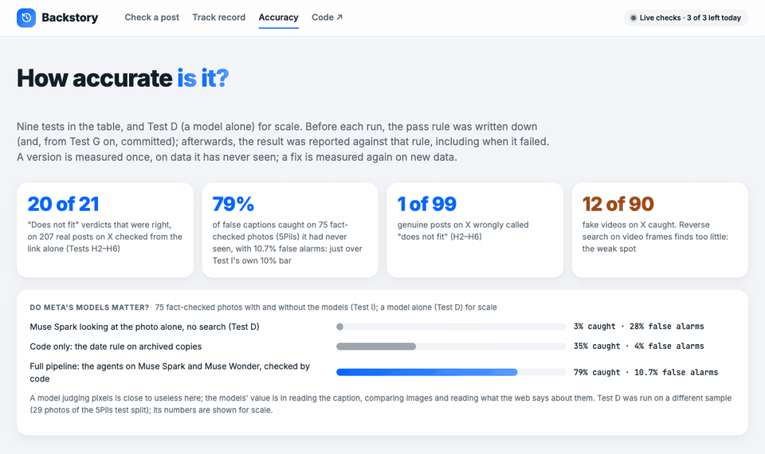
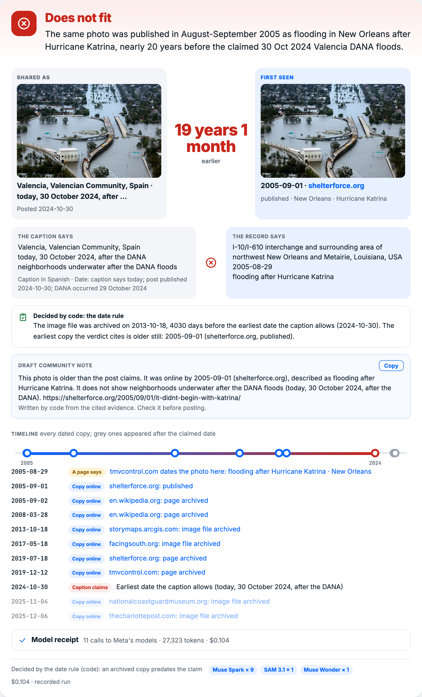
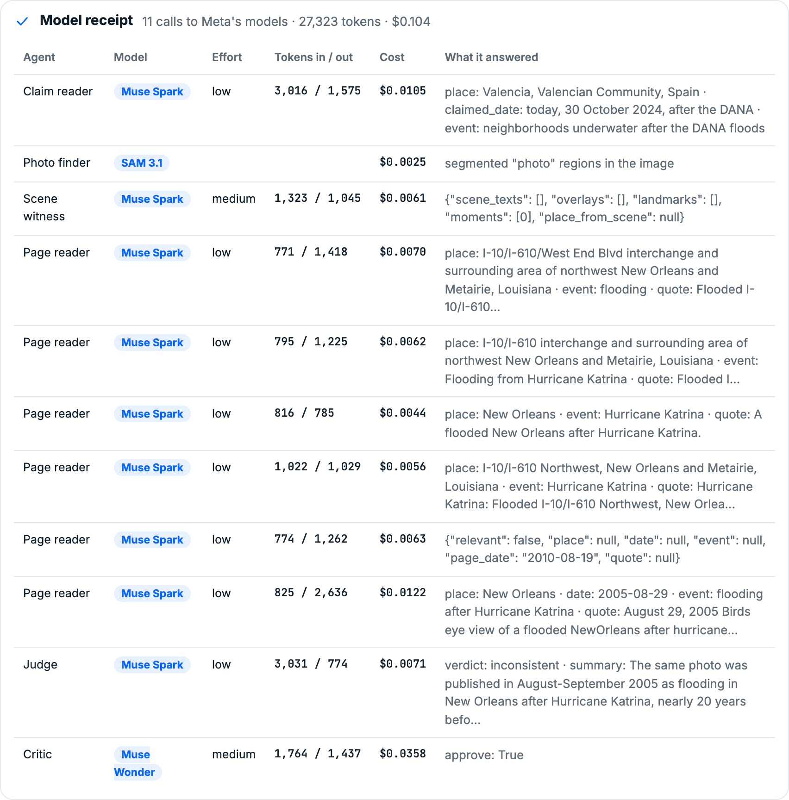
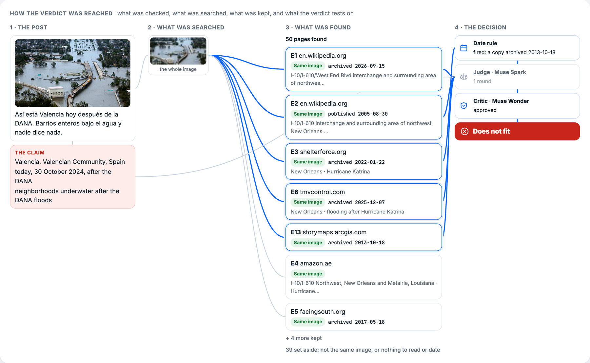
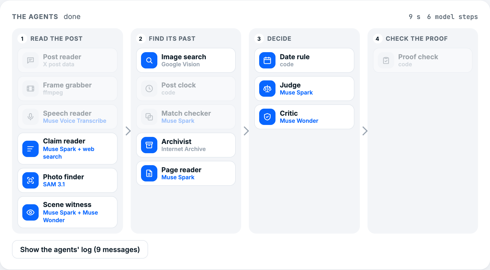
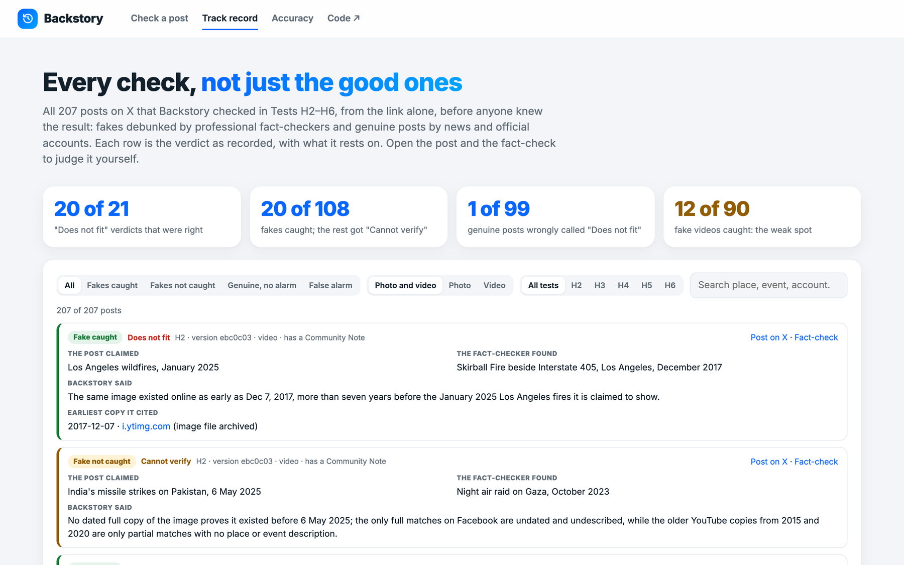
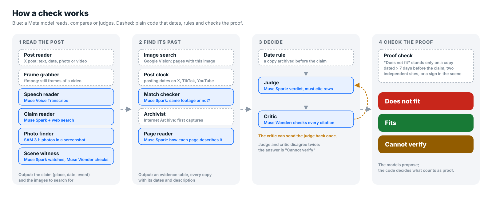

<p align="center">
  
</p>

# Backstory

**Real photo, wrong story? Backstory checks a viral photo or video against its own past online, and tells you whether the caption fits it.**

Meta AI Developer Hackathon 2026 · Indie Developer track · Team CurrentSky (Stanislav Gatin, solo)

<!-- The two buttons get their real links once the public copy and the video are up. -->
<p align="center">
  <a href="#quick-start"></a>&nbsp;
  <a href="#quick-start"></a>
</p>

<p align="center">
  <a href="#quick-start"><b>Quick start</b></a> ·
  <a href="#how-it-works">How it works</a> ·
  <a href="#metas-models-what-each-one-does">Meta's models</a> ·
  <a href="#when-something-goes-wrong">When something goes wrong</a> ·
  <a href="#results">Results</a> ·
  <a href="#scope-and-limitations">Limitations</a>
</p>

[](https://github.com/stas-gatin/backstory/actions/workflows/ci.yml)

| | |
|---|---|
| **Input** | A link to a post on X, or a photo or video with the caption it was shared with |
| **Output** | **Does not fit**, **Fits** or **Cannot verify**, with the evidence: every earlier copy of the media found online, its dates, what each page says, and the proof the verdict rests on |
| **Runs on** | 15 steps: 8 on **Muse Spark**, **Muse Wonder**, **Muse Voice Transcribe** and **SAM 3.1** through the Meta Model API; the rest are tools and plain code for search, archive dates, rules and proof |
| **Start** | `docker compose up --build`, then open http://localhost:8000. Offline, no keys needed ([Quick start](#quick-start)) |

### Where to find what

| You want | Go to |
|---|---|
| Run it: one command, offline, no keys | [Quick start](#quick-start) |
| The agents and how they hand work to each other | [How it works](#how-it-works) · [`backstory/pipeline.py`](backstory/pipeline.py) |
| What each Meta model does, and why | [Meta's models](#metas-models-what-each-one-does) |
| Whether it works: nine tests, rules written before each run, failures included | [Results](#results) · [`docs/`](docs/) · in the app: `/tested` |
| Every one of the 207 posts on X it checked, with its verdict and evidence | [The track record](#the-track-record) · [`eval/track_record.json`](eval/track_record.json) |
| What happens when evidence is missing or a step fails | [When something goes wrong](#when-something-goes-wrong) |
| Every external call recorded; the examples replay offline from the repository | [`backstory/replay.py`](backstory/replay.py) · [`replay/`](replay/) |
| The evaluation code | [`eval/fivepils.py`](eval/fivepils.py) (fact-checked photos) · [`eval/realset.py`](eval/realset.py) (posts on X) |

<p align="center">
  
</p>

---

## The problem in one minute

When something terrible happens, the photos that spread fastest are often real, but from somewhere else. Footage
of a 2017 wildfire went around as the January 2025 Los Angeles fires. A crowd at Athens airport was shared as
people fleeing Israel. A flood photo from years before became "Valencia today". The pixels are genuine, so a detector that looks for edited or AI-made images sees nothing wrong. What is
wrong is the caption.

Fact-checkers catch these by hand: reverse image search, find the oldest copy, read where it came from, compare
with the caption. It takes them from minutes to hours per post, and the false version spreads in the meantime.

Backstory does that work with agents. It finds where the exact photo or video appeared online before, dates every
copy, reads how each page describes it, and checks the caption against that record. Every verdict cites its
evidence, and code, not a model, has the last word on what counts as proof. When there is no record, the answer is
"Cannot verify", never a guess.

---

## What you get

### The verdict, and why

The verdict comes first: the post as it was shared next to the earliest dated copy of the same image, with the time
between them; what the caption says against what the record says (with how the claim reader read the caption:
its language, and how it got the date); the proof the code accepted; a draft Community Note built from the cited
evidence, next to the post's real Community Note when it has one (never shown to the agents); and a timeline of
every dated copy, with the ones that appeared after the claimed date greyed out.



### Every model call, on a receipt

Each check lists every call to Meta's models: which agent made it, the model, the reasoning effort, the tokens,
the cost, and the gist of what the model answered.



### How the verdict was reached

A graph of the whole check: the post and its claim, the parts of the media that were searched (the photo,
cut-outs, video frames, the moments a model picked, signs read in the scene), the copies that were kept or set
aside, and the steps that decided. The blue lines are what the verdict rests on.



### The agents at work

Fifteen steps in four stages, eight of them on Meta's models: read the post, find its past, decide, check the
proof. Each lights up while it works and names the model it runs on; steps a post does not need stay grey. When
the critic sends the judge back, that step turns amber, and the exchange between the two models is shown with the
verdict. The agents' log folds into one line once the verdict is in.



### The track record

All 207 posts on X checked in Tests H2–H6, not just the good ones: each with the fact-checker's finding, Backstory's
verdict, the earliest copy it cited, and links to the post and the fact-check, filterable by outcome, media and
test (`/record`, data in [`eval/track_record.json`](eval/track_record.json), text and links only).



The examples in the repository are staged on public-domain photos (U.S. Coast Guard and U.S. Navy, see
[`examples/CREDITS.md`](examples/CREDITS.md)): a 2005 New Orleans flood photo shared as the 2024 Valencia floods, and a
2011 tsunami photo shared as the 2025 Kamchatka tsunami. "Fits" is shown by a genuine post (Jakarta floods).

---

## How it works

<p align="center">
  
</p>

| Stage | Agent | Runs on | What it does |
|---|---|---|---|
| Read the post | Post reader | X embed data (no account) | From a link: the post's text, date, photos or video. Its Community Note is kept for comparison, never given to the agents |
| | Frame grabber | ffmpeg | Video: four still frames to search for |
| | Speech reader | **Muse Voice Transcribe** | Video: the words spoken in it, which join the caption as part of what the post claims |
| | Claim reader | **Muse Spark** + web search | Place, event and date the caption claims, in any language. Resolves "yesterday" or a named event to a date. A post that presents media as news with no date is taken as no older than 30 days before the post |
| | Photo finder | **SAM 3.1** | Uploaded images only: cuts the separate photos out of a screenshot or collage; each is searched along with the whole image |
| | Scene witness | **Muse Spark** watches, **Muse Wonder** checks | Spark watches the first minute of the video (or looks at the photo) for readable signs and landmarks, and picks the most distinctive moments, which are searched too. Each sign that names a place is checked by Wonder on its own frame |
| Find its past | Image search | Google Cloud Vision | Pages that show the image (Meta's API has no image search) |
| | Post clock | code | Exact posting dates of copies on X and TikTok (from the post id) and YouTube (from the page's metadata) |
| | Match checker | **Muse Spark**, two images | When exact matches are scarce (video frames, crops, re-encodes), compares each look-alike with the post and keeps only the same photo or footage |
| | Archivist | Internet Archive | First archived capture of each page and image file: proof it existed by that date |
| | Page reader | **Muse Spark** | Reads each page: where, when and what it says the photo shows |
| Decide | Date rule | code | If an image file that matched the search (fully or in part) was archived more than a day before the earliest date the caption allows, the caption cannot be right. This rule decides on its own; it was tested first and alone (Test E: 49% caught, 1% false alarms) |
| | Judge | **Muse Spark**, sees the photo | Weighs the evidence table; its verdict must cite rows |
| | Critic | **Muse Wonder** | Checks every citation, looks at up to two cited look-alikes itself, and can send the judge back once. If it still disagrees, the answer is "Cannot verify" |
| Check the proof | Proof check | code | When the date rule did not fire, the judge's approved "Does not fit" must rest on proof the code can find in the table: a copy of the same image dated more than 7 days before the claim, two independent non-social sites that describe it differently, or a sign in the scene, confirmed on its frame, that names another country. Otherwise the answer becomes "Cannot verify" |

**Why it is agents, not a chain.** The critic can stop the judge and send it back; the proof check can overrule
both when they say "Does not fit"; the match checker throws out look-alikes the search engine returned; the scene witness's readings count only
after a second model confirms them on the frame. All agents share one evidence table, and every row the verdict
cites is shown to the user.

---

## Meta's models: what each one does

| Model | Agents | Why this model |
|---|---|---|
| **Muse Spark 1.3** | claim reader (with its web search tool), match checker, page reader, judge, scene witness | Reads captions in any language and resolves dates with web search; compares two images; reads web pages; watches a video (`input_video`, first minute) |
| **Muse Wonder 1.0** | critic, scene witness check | The stronger model checks the cheaper one: every citation the judge makes, and every place-naming sign the witness reads |
| **Muse Voice Transcribe** | speech reader | What is said in a video is part of what the post claims |
| **SAM 3.1** | photo finder | Finds the photos inside an uploaded screenshot of a post, so each is searched on its own. Test G found that searching the cut-out *instead of* the screenshot is worse (NO-GO), so cut-outs are only searched *in addition*; that use was not measured end to end |

The two staged examples each make 9 Muse Spark calls, 1 Muse Wonder call and 1 SAM call, and cost $0.09–0.10.
On the posts of Tests H2–H6 a check cost $0.06–0.10 in the median and at most $0.23. Once a check has spent $0.30
(`BACKSTORY_COST_CAP`), it starts no new model call.

**Do the models matter?** On 75 fact-checked photos the pipeline had never seen (Test I), plain code (the date rule
on archived copies) caught 35% of false captions with 4% false alarms; the full pipeline caught 79% with 10.7%. The
models more than double the catches and add some false alarms. Muse Spark looking at the photo alone, with no
search, caught 3% with 28% false alarms (Test D, a different sample of 29 photos). The models' value is in reading the caption, comparing images and reading
what the web says, not in judging pixels.

---

## When something goes wrong

**No evidence, no verdict.**
- No earlier copy found: "Cannot verify", with the reason. Fabricated or AI-made images have no past and get the same answer.
- The judge (with the critic's approval) says "Does not fit" but the proof is weak (one page, a copy only days older, only unconfirmed partial matches): the proof check turns it into "Cannot verify" and says why.
- The judge and the critic still disagree after one send-back: "Cannot verify".

**Checks nobody asked for.**
- The **match checker** rejects look-alikes that are a similar scene but not the same photo or footage.
- The **proof check** ignores a page's archive date (the page may be older than the photo) and the creation date of wiki articles; it needs the image itself to be dated before the claim. (The date rule, which decides on its own, uses archived image files only.)
- The **scene witness** only counts a sign that a second model confirms on its frame, that is part of the filmed scene (not a caption or watermark added later), and that could not plausibly be seen at the claimed place (flags, placards, adverts, chain stores and departure boards can).
- The X **Community Note** is never given to the agents; fact-checking sites and debunk-looking URLs are removed from the search results in every test.

**A step that fails does not end the check.**
- One page that will not open, one archive lookup that times out, one frame that cannot be searched: the others still count, and the table says "Page did not open".
- A cost cap per check ($0.30) stops starting new model calls.
- Bad input is rejected before any model is called: not a photo or video, too small, too large, no caption.

**Afterwards, everything can be traced.**
- Every external answer (models, search, archive, pages) is recorded by a hash of its request ([`backstory/replay.py`](backstory/replay.py)); the examples in this repository replay offline, step by step, to the same verdict. The test runs' recordings are kept locally, not in the repository (they hold third-party media).
- The evidence table shows every copy with its dates and how it was dated, and marks the rows the verdict cites.

---

## Results

<p align="center">
  
</p>

Nine tests, each on data the version under test had never seen. **Before each run, the pass rule was written down**
(and, from Test G on, committed before the run); afterwards, the result was reported against it, including when it
failed. The reports, rules first: [`docs/TESTS.md`](docs/TESTS.md) (Tests D, E), [`docs/TEST_G.md`](docs/TEST_G.md)
(G), [`docs/TEST_H.md`](docs/TEST_H.md) (H1–H6), [`docs/TEST_I.md`](docs/TEST_I.md) (I).

| Test | What changed | Data | Caught | False alarms | Pre-registered rule |
|---|---|---|---|---|---|
| E | Core method: archive dates + Muse Spark reading the evidence | 105 fact-checked photos ([5Pils](https://github.com/UKPLab/5pils)) | 67% | 8.6% | passed (GO) |
| G | SAM 3.1 cut-out searched *instead of* the screenshot | 17 synthetic post screenshots | found 65% vs 82% | | **failed** (NO-GO): SAM is used only in addition |
| H1 | Full agent pipeline: judge, critic, match checker | the same 105 photos | 79% | 22.9% | **failed**: false alarms > 10% |
| I | + proof check in code | 75 new fact-checked photos | 78.7% | 10.7% | **failed, narrowly**: false alarms > 10% |
| H2 | Same version as I, on real posts | 53 posts on X, link only | 6 / 25 | 1 / 28 | no bar (first look) |
| H3 | + match checker confirms look-alikes | 39 fresh posts on X | 5 / 23 | 0 / 16 | **failed**: caught < 35% |
| H4 | + a news post with no date is taken as recent | 14 posts no version had seen | 3 / 6 | 0 / 8 | counts only (too small for a rate) |
| H5 | + post clock, A/B against H4's version | 56 fresh video posts | 5 / 31 (vs 6) | 0 / 25 | **failed**: no gain |
| H6 | + scene witness, A/B against H5's version | 45 fresh video posts | 1 / 23 (vs 1) | 0 / 22 | **failed**: no gain |

**Across the 207 posts on X (H2–H6), checked from the link alone** (pooled over five successive versions, each on its
own fresh posts): Backstory said "Does not fit" 21 times and was right 20 times. It flagged 1 of 99 genuine posts. It caught 8 of 18 fake photos and 12 of 90 fake videos: when
reverse search finds nothing usable, which happens for most fake videos, it says "Cannot verify".

**What the failures taught.**
- **H1: the judge was too eager.** It took a copy a few days older than the claim, or one page with a different description, as proof. The fix was the proof check in code; on new data false alarms were about half (Test I, a different split), though still just over the 10% bar.
- **H3: news posts rarely give a date.** "First picture of a chemical attack in Kursk" names no date, so a copy from 2016 had nothing to beat. The fix: a post presented as news is taken as no older than 30 days before it was posted.
- **H5, H6: video stays hard.** Two ideas, each tested A/B on fresh posts, gave no gain. For a third of the fake videos, reverse search finds nothing for any frame.
- One fix came after all tests: the creation date of a wiki article no longer counts as a date for the photo in it. No verdict in any test rested on such a date alone.

**Fresh posts, October 2026** ([`docs/FRESH.md`](docs/FRESH.md)): after the freeze, ten viral fakes from this month,
debunked by fact-checkers, were checked live from the link alone. Backstory caught 4 of 10 and said "Cannot verify" on
the other 6. Not pre-registered; a look at current posts, not a measurement.

The same numbers, with the comparison against plain code, are on the app's **Accuracy** page (`/tested`).

---

## Quick start

### One command, offline (Docker)

You need [Docker](https://docs.docker.com/get-docker/) and Git.

```bash
git clone https://github.com/stas-gatin/backstory.git
cd backstory
docker compose up --build
```

Open http://localhost:8000. With no keys, Backstory runs in **replay mode**: eleven recorded checks replay step by step,
from text-only recordings of every agent's step (`examples/recorded/`). Nine are real posts on X (the post itself is
shown through X's own embed, so its media loads from X). Two are staged on public-domain photos; the recorded answers
of their external calls are in `replay/`. Stop it with Ctrl+C.

### Live, with keys

```bash
cp .env.example .env    # then fill in MODEL_API_KEY (Meta Model API) and GOOGLE_VISION_API_KEY
docker compose up --build
```

Now any link to a post on X, or any uploaded photo or video with its caption, is checked live, and every new
answer is recorded into `replay/` (mounted from your checkout by `docker-compose.yml`).

### A public copy with live checks

With keys, a public copy limits live checks so the credits cannot run out by accident
([`backstory/limits.py`](backstory/limits.py)): 3 a day per visitor (`BACKSTORY_LIVE_PER_VISITOR`), $5 a day
(`BACKSTORY_LIVE_DAY_USD`) and $40 in total (`BACKSTORY_LIVE_TOTAL_USD`), at most two at a time. If the Meta Model
API stops answering (for example, no credit left), live checks pause for half an hour and the page says so. The
recorded checks and the track record are never limited, so the site keeps working with no credit at all.

### Without Docker

You need Python 3.12 and ffmpeg.

```bash
python -m venv .venv && .venv/bin/pip install -r requirements.txt
.venv/bin/uvicorn backstory.server:app --port 8000
```

### Tests

```bash
.venv/bin/pip install -r requirements-dev.txt
.venv/bin/python -m pytest -q tests     # 63 offline tests: every external call is replaced by a stand-in
```

### Evaluation

```bash
git clone https://github.com/UKPLab/5pils data/5pils
.venv/bin/python -m eval.fivepils --split train --sample 100 --max-usd 13 --out runs/test_i.json      # Test I's data and settings
.venv/bin/python -m eval.realset --set eval/realset2.json --max-usd 3 --out runs/test_h3.json        # Test H3's posts on X
```

These run the current code, not the version each test measured; each test's commit, data and rule are in its report
in [`docs/`](docs/).

### API

`POST /api/check` takes a form with either `post_url` (a link to a post on X), or `image` (a photo or video file)
with `caption` and an optional `posted_on`, or `example_id`. It streams NDJSON events: `step` (an agent starts or
finishes, with what it found), `evidence` (a row of the evidence table), and finally `result` (verdict, basis,
summary, claim, the record's place, date and event, timeline, cited rows, proof, cost) or `error`.

```bash
curl -N -X POST -F example_id=valencia http://localhost:8000/api/check
```

---

## Scope and limitations

- **Real media with a false caption.** Backstory checks where and when a photo or video was before. It does not detect edited or AI-generated images; those have no past and get "Cannot verify".
- **It needs an earlier copy online.** Most fake videos on X have none that reverse search can find (H5, H6).
- **Image search is Google Cloud Vision.** The Meta Model API has no reverse image search; everything that reads, compares or judges runs on Meta's models.
- **Dates on the web are noisy.** Archive captures can be late, and pages can be updated. The proof check allows a week's margin and ignores page archive dates and wiki creation dates; the date rule allows one day and uses archived image files only, including partial matches. In Test I, 3 of the 8 false alarms came from the date rule, where an archived file predated the fact-checker's own date.
- **A page's publication date can be older than an image on it.** Pages show newer pictures in sidebars and updated articles. The proof check accepts the publication date of a page whose image fully matches; one recorded catch in the tests (H3, the Seoul tanks post) was right but rested on such a date: a 2023 article about another subject that later showed the 2024 photo.
- **Models vary.** Two live runs of the same post can differ; the critic and the proof check narrow this, and the recordings make every run reproducible.

---

## Repository

```
backstory/   the agents and the pipeline (pipeline.py), the Meta Model API client, record/replay, the web server
web/         the app: verdict, check graph, agent map, model receipt, evidence, track record, How it was tested
eval/        evaluation on 5Pils and on posts on X, the frozen post sets, the track record, the demo builder
docs/        the test reports, each with its rule written before the run; README images
examples/    the offline example cases (public-domain photos, staged captions)
replay/      the recorded answers the examples replay from
tests/       offline tests
```

## Data, media and licences

| | Used for | Licence / terms |
|---|---|---|
| [5Pils](https://github.com/UKPLab/5pils) (UKPLab) | Evaluation on fact-checked photos | CC-BY-SA-4.0; downloaded, not redistributed |
| Posts on X in `eval/realset*.json` | Evaluation on real posts | Links and short descriptions only; no media is stored in the repository |
| `examples/katrina.jpg`, `examples/sendai.jpg` | The offline examples | Public domain (U.S. Coast Guard, U.S. Navy), see [`examples/CREDITS.md`](examples/CREDITS.md) |
| `replay/` | The public-domain examples' recorded answers | Titles, dates, short excerpts and captions of the pages where the photos appear, and the models' answers |
| `examples/recorded/` | Recorded checks of seven real posts on X | Each agent's messages, the evidence rows (links, dates, descriptions) and the verdict; no media. The post is shown through X's official embed |

Everything in this repository was written during the hackathon (26 October – 4 November 2026). Code: MIT.
